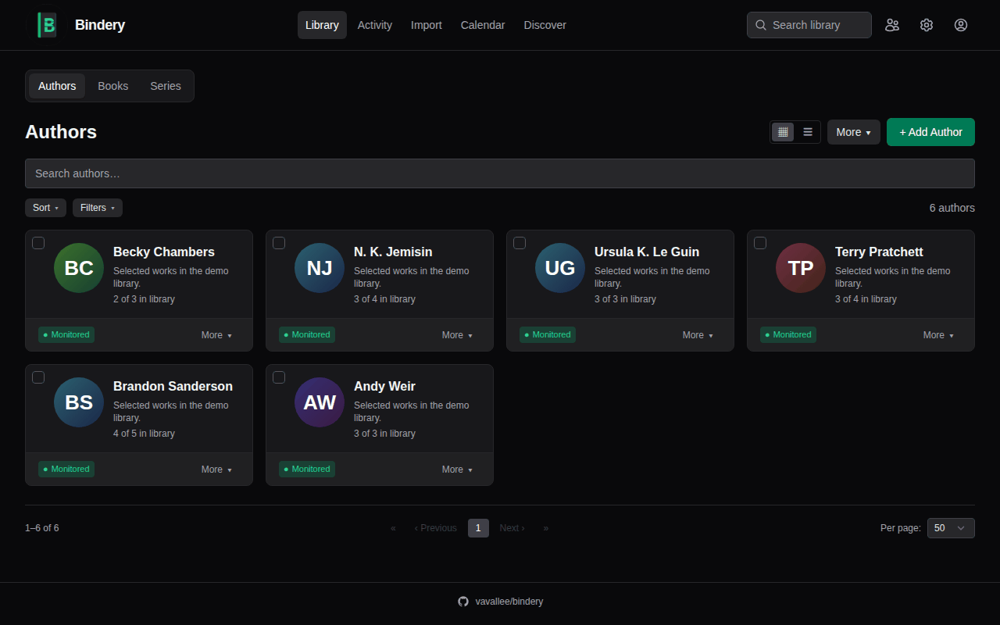
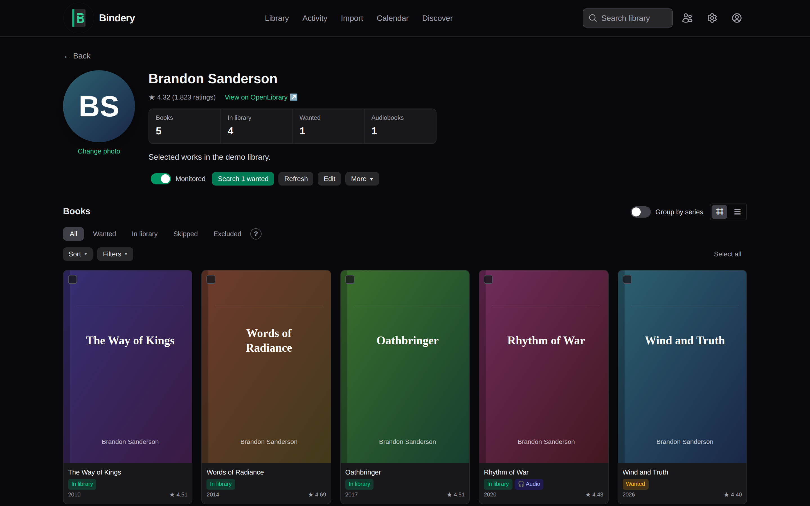
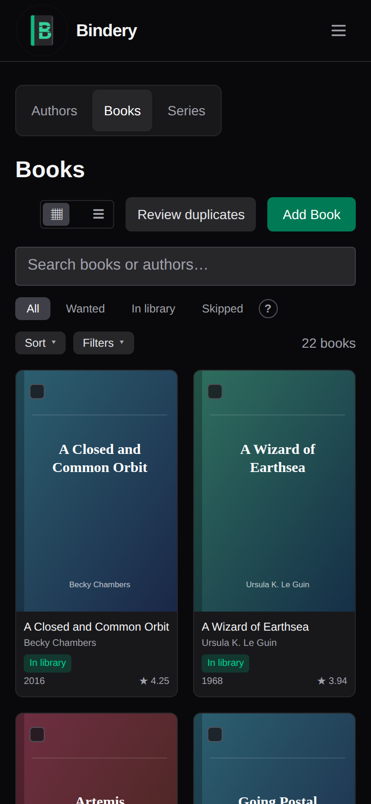
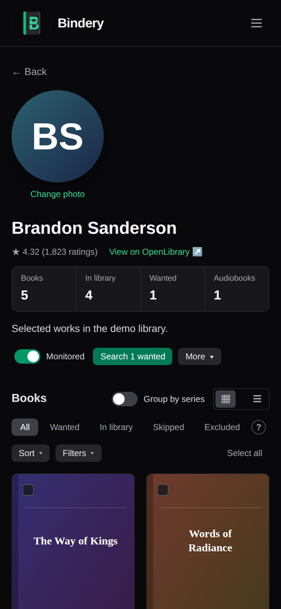

<p align="center">
  
</p>

<h1 align="center">Bindery</h1>

<p align="center">
  <strong>Ebooks and audiobooks, followed, fetched, checked and filed. One app, one binary.</strong><br>
  Bindery follows the authors you read, searches your Usenet and torrent indexers, grabs the best release, checks it is the right book, and files it where your reading and listening apps expect it.
</p>

<p align="center">
  <a href="https://github.com/vavallee/bindery/actions/workflows/ci.yml"></a>
  <a href="https://codecov.io/gh/vavallee/bindery"></a>
  <a href="https://github.com/vavallee/bindery/releases"></a>
  <a href="https://github.com/vavallee/bindery/releases"></a>
  <a href="https://github.com/vavallee/bindery/pkgs/container/bindery"></a>
  <a href="https://hub.docker.com/r/vavallee/bindery"></a>
  <a href="https://scorecard.dev/viewer/?uri=github.com/vavallee/bindery"></a>
  <a href="https://github.com/vavallee/bindery/blob/main/LICENSE"></a>
  <a href="https://discord.gg/RpuYYRM9cZ"></a>
</p>

---

<p align="center">
  
</p>

## Why Bindery

If you used Readarr, you know the loop: follow an author, let the app search, grab, import and rename. Readarr was retired in June 2025 because, in the maintainers' words, "the project's metadata has become unusable". Bindery is a fresh, MIT licensed implementation of that loop, built in Go, with both ebooks and audiobooks as first class citizens and with metadata from open sources you can switch between.

What it does well:

- **Ebooks and audiobooks on the same book.** One title holds an ebook and an audiobook in separate slots, each with its own search, quality profile, download folder and library root. Send ebooks to Calibre or Calibre-Web Automated and audiobooks to Audiobookshelf from one instance, instead of running two.
- **Follows authors and keeps trying.** Monitored authors are checked for new books on a schedule you choose, wanted books are searched automatically, failed downloads are retried, and a release the filters set aside can still be grabbed by hand with the reason shown.
- **Checks what it imports.** Before a file joins your library, Bindery reads it: an EPUB, Kindle file or audiobook whose embedded title, author or language says it is the wrong book is refused, its release is blocklisted, and the search runs again.
- **Built to share.** Give family and friends a requester account that can browse and ask for books but cannot download or change anything. Approve requests from a queue, auto approve trusted accounts, cap pending requests, and sign people in with OIDC or your reverse proxy.
- **Brings your library with you.** Import a Readarr database, a Goodreads CSV, a Calibre library or an Audiobookshelf server, then adopt files already on disk in place, with suggested matches and Undo.
- **Open metadata you control.** OpenLibrary, Hardcover, Google Books, the German, Norwegian and French national libraries, plus Audnex and Audible for audiobooks. Pick your primary, switch any enricher off, and lock fields you have corrected. No scraping.
- **Boring to run, easy to verify.** A single Go binary with the UI embedded and SQLite inside. Distroless image, Helm chart, binaries for Linux, macOS and Windows, and signed releases with build provenance you can check with `gh attestation verify`.

<p align="center">
  
</p>

## Quick start

### Docker Compose

```yaml
services:
  bindery:
    image: ghcr.io/vavallee/bindery:latest
    container_name: bindery
    user: "1000:1000"   # the uid:gid that owns your books and downloads
    ports:
      - 8787:8787
    volumes:
      - ./config:/config
      - /media/books:/books
      - /media/downloads:/downloads
    environment:
      - BINDERY_LOG_LEVEL=info
    restart: unless-stopped
```

Open <http://localhost:8787>, create the admin account on the first run page, add an indexer and a download client in **Settings**, and add your first author.

The image is distroless and cannot switch users at runtime, so `user:` is how you set the UID that writes your library. `BINDERY_PUID` and `BINDERY_PGID` only assert that it came out right.

### Docker

```bash
docker run -d \
  --name bindery \
  -p 8787:8787 \
  -v /path/to/config:/config \
  -v /path/to/books:/books \
  -v /path/to/downloads:/downloads \
  ghcr.io/vavallee/bindery:latest
```

### Other install methods

The container image is built for amd64 and arm64. Release binaries cover Linux (amd64, arm64, armv7 and armv6, so a Raspberry Pi Zero works), macOS and Windows. Kubernetes users get a Helm chart in `charts/bindery/`, and Unraid has a Community Applications template. All of it, with UID and GID setup, path remapping and upgrade notes, is in **[docs/DEPLOYMENT.md](docs/DEPLOYMENT.md)**. New to the *arr style of app? **[docs/QUICKSTART.md](docs/QUICKSTART.md)** goes from zero to a first download.

### Coming from Readarr

```bash
bindery migrate readarr /path/to/readarr.db
```

Your authors, indexers, download clients and blocklist come across in one step. Authors are looked up again against Bindery's metadata providers, since Readarr's own backend is gone. Your files stay where they are: point a library scan at them and Bindery matches what it can and lists the rest on the Import page for you to adopt. Prefer the UI? **Settings, Import**. Full guide: [Migrating from Readarr](docs/Migrating-From-Readarr-Wiki.md).

## How Bindery fits

Book automation has become a busy and friendly space since Readarr's retirement, and Bindery is one of several good options. The tables describe each project by what its own README says it does, as of November 2026. If something here is out of date or unfair to a project, please [open an issue](https://github.com/vavallee/bindery/issues) and it will be fixed.

**Managers that follow authors and fetch books for you**

| | Ebooks | Audiobooks | Requests from other users | Status |
|---|---|---|---|---|
| **Bindery** | Yes | Yes, on the same book as the ebook | Yes, requester role with approvals | Active |
| [Chaptarr](https://github.com/Chaptarr/chaptarr) | Yes | Yes, in the same instance, narrator aware, MP3 to M4B conversion | Not stated | Beta |
| [LazyLibrarian](https://gitlab.com/LazyLibrarian/LazyLibrarian) | Yes, plus magazines and comics | Yes | User accounts | Active, long running |
| [Bookshelf](https://github.com/pennydreadful/bookshelf) | Yes | Yes, one format per instance | No | Active Readarr revival |
| [Readarr Redux](https://github.com/dervish666/readarr-redux) | Yes | Yes, one format per instance | No | Active Readarr continuation |
| [ReadMeABook](https://github.com/kikootwo/ReadMeABook) | Secondary | Yes, its focus, with series watching | Yes | Active |
| [Livrarr](https://github.com/kkodecs/livrarr) | Yes | Yes, plus a built in reader and player | Single user for now | Alpha |
| [Readarr](https://github.com/Readarr/Readarr) | Yes | Yes, one format per instance | No | Retired June 2025 |

If you want to keep running Readarr itself, Readarr Redux and Bookshelf are the closest continuations. If you need audio conversion today, Chaptarr does it in app. If you want both formats of a book handled together, household requests, and open metadata in a single small binary, that is what Bindery is built for.

**Tools that pair well with Bindery**

| | What it does | How it works with Bindery |
|---|---|---|
| [Audiobookshelf](https://github.com/advplyr/audiobookshelf) | Audiobook server and player with mobile apps and progress sync | Bindery imports an existing Audiobookshelf library and asks it to rescan after every audiobook import |
| [Calibre](https://calibre-ebook.com) | Desktop ebook manager and converter | Each import is registered through `calibredb` or the [Bindery Bridge plugin](https://github.com/vavallee/bindery-plugins), even with Calibre on another machine |
| [Calibre-Web Automated](https://github.com/crocodilestick/Calibre-Web-Automated) | Web library and reader with Kobo and KOReader sync | Bindery copies each ebook into its ingest folder |
| [Grimmory](https://grimmory.org) | Web library for ebooks, comics and audiobooks | Bindery pushes imports to its BookDrop inbox (preview) |
| [Kavita](https://github.com/Kareadita/Kavita), [Komga](https://github.com/gotson/komga) | Reading servers | Point them at Bindery's ebook folder |
| [Shelfmark](https://github.com/calibrain/shelfmark) | On demand search and download across many sources | A different shape: Shelfmark for one off finds, Bindery for the authors you follow |
| [AudioBookRequest](https://github.com/markbeep/AudioBookRequest) | Request front end for audiobooks | Bindery's request API can file a request on a user's behalf |
| [Storyteller](https://gitlab.com/storyteller-platform/storyteller) | Read along books from an ebook and audiobook you own | Bindery can fetch both formats of the same title for it |
| KOReader, Moon+ Reader and other OPDS apps | Reading apps | Browse, search and download from Bindery's OPDS catalogue |

### What Bindery does not do yet

Being upfront saves everyone time. These are tracked, and the [roadmap](docs/ROADMAP.md) says what is next:

- **Upgrading a book you already own** to a better format when one appears ([#2420](https://github.com/vavallee/bindery/issues/2420)). Today an imported book is not searched again.
- **A monitored series finding its own new books** ([#2523](https://github.com/vavallee/bindery/issues/2523)). Monitored authors find new books; Fill gaps on a series is a manual action.
- **Grouping editions and translations** of one work under a single book ([#1358](https://github.com/vavallee/bindery/issues/1358)).
- **Audio conversion, M4B merging and chapter editing.** Audiobookshelf's M4B encoder covers this well.
- **A built in reader or player, or reading progress sync.** Audiobookshelf, Calibre-Web Automated, Kavita and Komga do this, and Bindery feeds them.
- **Shadow libraries, IRC, Soulseek and magazines** are out of scope; see the roadmap's standing answers.

## Features

<details open>
<summary><strong>Following authors and finding books</strong></summary>

- Author monitoring with per install and per author modes (all, future, latest, none, or only the series you pick), per book monitor toggles, and a wanted to imported workflow with live download progress.
- Unattended release discovery: monitored authors are checked for new books daily, weekly or monthly. It ships off; turn it on in **Settings, General, New release discovery**.
- Series pages with positions, gap detection against Hardcover, Fill gaps, and adding a whole Hardcover series in one step.
- Hardcover list sync on an interval, Goodreads CSV import, and a Discover page with recommendations from your library: next in series, new from monitored authors, genre similarity and your Hardcover wishlist.
- A release calendar of upcoming books.

</details>

<details>
<summary><strong>Search and downloads</strong></summary>

- Newznab and Torznab indexers queried in parallel and ranked by your format order, edition tags (RETAIL, UNABRIDGED, ABRIDGED), year, grabs, size and ISBN match. Prowlarr can sync its indexers into Bindery, with seed ratio and seed time per indexer.
- SABnzbd, NZBGet, qBittorrent, Transmission, Deluge and rTorrent or ruTorrent, with SSL and URL base support. Pin an indexer to a download client, and remove a torrent once it is imported and seeded.
- **Diagnose** on each download client checks the connection, the category, where grabs land, the path remap, read access, and whether imports can hardlink, then names the first thing to fix. No shell needed, which matters in a distroless image.
- Automatic search on an interval and on add, interactive search per book, and a global pause. Quality profiles per media type, language filter, custom formats, delay profiles, freeleech only indexers, a blocklist, and a per indexer daily query limit with polite back off when an indexer refuses.
- Failed downloads can be retried one at a time or all at once. Releases the filters set aside stay visible in interactive search with the reason, and you can still grab them.
- Multi book packs are recognised and not auto grabbed; manual import splits one across several books.

</details>

<details>
<summary><strong>Importing and organising</strong></summary>

- Completed downloads are placed in your library with your naming template. Import modes: Auto (hardlink when it can so torrents keep seeding, otherwise copy; Usenet is moved), Move, Copy, Hardlink, or External to hand off to another tool. Moves across filesystems are copied, verified and then removed. A second book that renders to a taken file name lands beside it as `Name (2).epub` instead of overwriting anything.
- Content checks before import: the embedded title, author and language of EPUB, Kindle and audio files are compared with the book, and a wrong book is refused, blocklisted and searched again.
- Naming tokens including `{Author}`, `{SortAuthor}`, `{Title}`, `{Year}`, `{Series}`, `{SeriesNumber}`, `{Genre}`, `{Lang}`, `{Narrator}` and `{ASIN}`, with conditional literals and zero padding. Reorganize renames an existing library to a new template.
- Several ebook formats of one book are kept side by side, and EPUB is served first in downloads and OPDS.
- Library adoption: a scan matches files already on disk, and whatever it cannot match waits on the Import page with suggested matches, an Add author choice and Undo. Files are registered where they are and never moved. When a folder path names a series and position, such as `Discworld/08 - Guards! Guards!`, you can put the book in that series as you adopt it.
- Import from a folder for one off imports, with a folder browser over your library and download folders, and a metadata search to create a book when nothing in the catalogue fits.
- Manual metadata edits with field locks that survive refresh, Fix match for a file attached to the wrong book, Re-bind to a different provider record, author aliases, and a duplicate review.
- Optional Calibre style `metadata.opf` written next to each book.

</details>

<details>
<summary><strong>Sharing and running it</strong></summary>

- Local accounts (argon2id), per account API keys, OIDC with any provider (setup guides for Google, GitHub through Dex, Authelia, Authentik and Keycloak), and forward auth from Authelia, Authentik or oauth2-proxy.
- Multi user: admins manage indexers, clients and users; each user gets their own monitored authors and downloads. Per user library isolation is turned on with `BINDERY_ENFORCE_TENANCY`; see [docs/multi-user.md](docs/multi-user.md).
- Requests: a requester account browses read only and asks for books or authors. Admins approve from a queue and the added books belong to the person who asked. Accounts can auto approve with a daily quota, pending requests are capped (25 by default), and request front ends can file on a user's behalf.
- Webhook notifications for grabs, imports, failures, new books found, new requests and health changes, ready for Apprise, ntfy, Home Assistant, Discord or Slack.
- Backups on demand, restore from the UI, a database integrity check, and `bindery db-check` and `bindery db-repair` for an instance that will not start.
- History records where each import came from: the release, indexer, download client and the exact files placed.
- A log viewer with a runtime debug switch, log download for bug reports, and an *arr compatible queue at `/api/queue` for tools like Harpoon.

</details>

<details>
<summary><strong>Interface</strong></summary>

- React 19 and TypeScript, light and dark themes, a mobile friendly layout, and installable as an app on phones and desktops.
- Library search in the header with an Add to library dialog that takes a title, author, ISBN or ASIN.
- Sorting, filtering and pagination on every list, with preferences remembered.
- Translations: English and Norwegian (Bokmål) complete, Swedish mostly, and Korean, French, German, Dutch, Spanish, Indonesian and Filipino in progress. [Translators welcome](CONTRIBUTING.md).
- An OPDS 1.2 catalogue with search at `/opds/` for KOReader, Moon+ Reader and other reading apps, signed in with your Bindery account or API key.

</details>

<p align="center">
  <picture>
    <source media="(prefers-color-scheme: dark)" srcset="docs/screenshots/books-mobile-dark.png">
    <source media="(prefers-color-scheme: light)" srcset="docs/screenshots/books-mobile-light.png">
    
  </picture>
  &nbsp;&nbsp;
  <picture>
    <source media="(prefers-color-scheme: dark)" srcset="docs/screenshots/author-detail-mobile-dark.png">
    <source media="(prefers-color-scheme: light)" srcset="docs/screenshots/author-detail-mobile-light.png">
    
  </picture>
</p>

## Metadata sources

All public APIs, no scraping. Audible's catalogue endpoint and Audnex are open but unofficial.

| Source | Auth | Used for |
|--------|------|----------|
| [OpenLibrary](https://openlibrary.org) | None | Default primary: authors, books, editions, covers, ISBN |
| [Hardcover](https://hardcover.app) | API token (free) | Ratings, series, lists and wishlist; can be the primary for a curated catalogue. Without a token it is skipped ([troubleshooting](docs/Troubleshooting-Wiki.md#a-book-is-on-hardcoverapp-but-doesnt-show-up-in-the-add-to-library-search)) |
| [Google Books](https://developers.google.com/books) | API key (free) | Descriptions and ratings |
| [DNB](https://www.dnb.de/) | None | German descriptions, language, year and publisher; can be the primary |
| [Nasjonalbiblioteket](https://www.nb.no/) | None | Norwegian catalogues under their original titles, with series; opt in primary only |
| [BnF](https://catalogue.bnf.fr/) | None | French editions under their French titles; opt in primary only. Data under the Licence Ouverte 2.0 ([credit and terms](docs/third-party-data.md#bibliothèque-nationale-de-france)) |
| [Audnex](https://api.audnex.us) | None | Audiobook narrator, duration and cover by ASIN |
| [Audible](https://audible.com) | None | Audiobook ASINs the others miss |
| [Wikidata](https://www.wikidata.org) | None | Author photos and bios, found by authority ID; off by default |

Each enricher can be switched off in **Settings, Metadata**. Covers are fetched and cached by the server, so your browser never contacts third party image hosts, and a book no provider has a cover for takes one from its own file.

## Configuration

Almost everything is set in the web UI under **Settings**. A few bootstrap settings are environment variables:

| Variable | Default | Purpose |
|----------|---------|---------|
| `BINDERY_PORT` | `8787` | HTTP server port |
| `BINDERY_DB_PATH` | platform default | SQLite database path |
| `BINDERY_DATA_DIR` | platform default | Config directory (backups, image cache, secrets) |
| `BINDERY_LIBRARY_DIR` | `/books` (set a real folder on Windows) | Imported ebook destination |
| `BINDERY_AUDIOBOOK_DIR` | inherits library | Imported audiobook destination |
| `BINDERY_DOWNLOAD_DIR` | `/downloads` (unset on Windows) | Where the download client puts completed jobs |
| `BINDERY_AUDIOBOOK_DOWNLOAD_DIR` | inherits download dir | Separate folder for audiobook downloads |
| `BINDERY_URL_BASE` | _(empty)_ | Reverse proxy subpath, for example `/bindery` |
| `BINDERY_OUTBOUND_PROXY` | _(empty)_ | Send outbound HTTP through an `http`, `https` or `socks5` proxy; LAN destinations bypass it by default |
| `BINDERY_ENFORCE_TENANCY` | `false` | Give each user a separate library; see [docs/multi-user.md](docs/multi-user.md) |
| `BINDERY_DOWNLOAD_RETENTION_DAYS` | `90` | Days to keep a finished download row; `0` keeps them all. Read [DEPLOYMENT.md](docs/DEPLOYMENT.md#environment-variables) before changing it on a long running install |
| `BINDERY_LOG_LEVEL` | `info` | `debug`, `info`, `warn` or `error` |
| `BINDERY_PUID` / `BINDERY_PGID` | _(unset)_ | Assert the container UID and GID; set the UID itself with `--user` or Compose's `user:` |

The full reference, including path remapping, API key seeding, trusted proxies and rate limits, is in **[docs/DEPLOYMENT.md](docs/DEPLOYMENT.md#environment-variables)**. OIDC and forward auth settings are in **[docs/auth-oidc.md](docs/auth-oidc.md)** and **[docs/auth-proxy.md](docs/auth-proxy.md)**.

## Supported integrations

| Category | Implementations |
|---|---|
| **Usenet clients** | SABnzbd, NZBGet |
| **Torrent clients** | qBittorrent, Transmission, Deluge, rTorrent and ruTorrent (XML-RPC over HTTP or SCGI) |
| **Indexers** | Newznab and Torznab, with per indexer categories; Prowlarr indexer sync |
| **Lists and imports** | Hardcover lists (synced), Goodreads CSV, Readarr database, Calibre `metadata.db`, Audiobookshelf |
| **Library tools** | Calibre (`calibredb` or the Bindery Bridge plugin), Calibre-Web Automated ingest, Grimmory (preview), a post import drop folder for anything that watches one ([guide](docs/Calibre-Integration-Wiki.md)) |
| **Notifications** | Webhooks for Apprise, ntfy, Home Assistant, Slack and Discord |
| **Authentication** | Local accounts, API keys, OIDC, forward auth proxy |
| **Reading apps** | OPDS 1.2 with search at `/opds/` |

## Architecture

Bindery is a single Go binary (chi router) with the React frontend embedded through `go:embed`, talking to SQLite in WAL mode through the pure Go `modernc.org/sqlite` driver. No CGO, no external database, no sidecars.

```
   Newznab / Torznab
      indexers
         │
         ▼
┌────────────────────────────┐
│         Bindery            │──► SABnzbd / NZBGet / qBit / Transmission / Deluge / rTorrent
│  Go backend + React SPA    │──► ebook and audiobook libraries
│  SQLite (WAL mode)         │──► Calibre / CWA / Audiobookshelf / Grimmory / webhooks
└────────────────────────────┘
    ▲                    ▲
    │                    │
OpenLibrary      Hardcover, Google Books, DNB, NB, BnF, Audnex, Audible
(default primary)          (enrichers and alternative primaries)
```

Components, package layout and design notes are in **[docs/ARCHITECTURE.md](docs/ARCHITECTURE.md)**.

## API

Every feature is available under `/api/v1/*`, with an *arr compatible `/api/queue` and the OPDS catalogue at `/opds/`.

```bash
# Add an author by OpenLibrary ID and start monitoring
curl -X POST -H "X-Api-Key: $KEY" -H "Content-Type: application/json" \
  -d '{"foreignAuthorId":"OL23919A","monitored":true,"searchOnAdd":true}' \
  http://bindery:8787/api/v1/author

# List wanted books
curl -H "X-Api-Key: $KEY" "http://bindery:8787/api/v1/book?status=wanted"
```

Endpoints, authentication and integration examples are in **[docs/API.md](docs/API.md)**.

## Documentation

| Topic | Where |
|-------|-------|
| **Quickstart**: zero to first download | [docs/QUICKSTART.md](docs/QUICKSTART.md) |
| **User guide**: how the app thinks, wanted and monitored, imports | [docs/User-Guide-Wiki.md](docs/User-Guide-Wiki.md) |
| **Deployment**: Docker, Compose, Helm, binaries, UID and GID, environment, upgrades | [docs/DEPLOYMENT.md](docs/DEPLOYMENT.md) |
| **Migrating from Readarr**: database import, Goodreads CSV, library scan | [docs/Migrating-From-Readarr-Wiki.md](docs/Migrating-From-Readarr-Wiki.md) |
| **Storage and hardlinks**: one mount layout, import modes, audiobook roots | [docs/Storage-And-Hardlinks-Wiki.md](docs/Storage-And-Hardlinks-Wiki.md) |
| **File naming**: every token, conditional groups, recipes | [docs/File-Naming-Wiki.md](docs/File-Naming-Wiki.md) |
| **Calibre and CWA**: the hand off options and troubleshooting | [docs/Calibre-Integration-Wiki.md](docs/Calibre-Integration-Wiki.md) |
| **Calibre on a Windows desktop**: plugin install, pull mode, push with a share | [docs/Calibre-Windows-Desktop-Wiki.md](docs/Calibre-Windows-Desktop-Wiki.md) |
| **Audiobookshelf import**: what comes across, review queue, rollback | [docs/ABS-Import-Wiki.md](docs/ABS-Import-Wiki.md) |
| **Hardcover series**: token setup, series linking, missing books | [docs/Hardcover-Series-Wiki.md](docs/Hardcover-Series-Wiki.md) |
| **Metadata editing**: manual edits, field locks, genre overrides | [docs/Metadata-Editing-Wiki.md](docs/Metadata-Editing-Wiki.md) |
| **Multi user and requests**: roles, isolation, requesters | [docs/multi-user.md](docs/multi-user.md) |
| **OIDC** and **forward auth** setup | [docs/auth-oidc.md](docs/auth-oidc.md), [docs/auth-proxy.md](docs/auth-proxy.md) |
| **Auth troubleshooting**: symptom, cause and fix | [docs/troubleshooting-auth.md](docs/troubleshooting-auth.md) |
| **Troubleshooting**: permissions, path remap, import failures | [docs/Troubleshooting-Wiki.md](docs/Troubleshooting-Wiki.md) |
| **Architecture** and **API** | [docs/ARCHITECTURE.md](docs/ARCHITECTURE.md), [docs/API.md](docs/API.md) |
| **Roadmap**: what is next and what is out of scope | [docs/ROADMAP.md](docs/ROADMAP.md) |
| **Changelog** | [CHANGELOG.md](CHANGELOG.md) |
| **Reverse proxy and SSO recipes** | [Wiki](https://github.com/vavallee/bindery/wiki/Reverse-proxy-and-SSO) |
| **Indexer and download client recipes** | [Wiki](https://github.com/vavallee/bindery/wiki/Indexer-and-downloader-recipes) |

## Community

- **Discord** for help, setup questions and release news: [discord.gg/RpuYYRM9cZ](https://discord.gg/RpuYYRM9cZ). Ask in `#support`; `#releases` gets every release.
- **GitHub Issues** for bugs and feature requests: [issues](https://github.com/vavallee/bindery/issues).
- **GitHub Discussions** for design questions, show and tell and integration recipes: [discussions](https://github.com/vavallee/bindery/discussions).

Please keep security reports out of Discord and public issues; [SECURITY.md](SECURITY.md) has the private channel.

## Security

<p>
  <a href="https://github.com/vavallee/bindery/security/code-scanning"></a>
  <a href="https://securityscorecards.dev/viewer/?uri=github.com/vavallee/bindery"></a>
  <a href="https://github.com/vavallee/bindery/security/dependabot"></a>
  <a href="SECURITY.md"></a>
</p>

Bindery holds API keys, reaches services on your network and writes to your disks, so it is built and checked with that in mind. Every push and a weekly run go through govulncheck, CodeQL, Semgrep, gitleaks, Hadolint, Checkov, Grype, Syft, a ZAP baseline and OpenSSF Scorecard, with gosec enforced in the blocking lint gate. Release binaries and the container image carry SLSA build provenance, which you can check with `gh attestation verify` ([how](docs/DEPLOYMENT.md)), and binaries ship with SBOMs. In the app: guards against server side request forgery on outbound URLs, strict response headers, and a distroless non root image with digest pinned bases. The Helm chart adds a read only root filesystem with every capability dropped.

To report a vulnerability, follow **[SECURITY.md](SECURITY.md)**. Published advisories are on the [Security tab](https://github.com/vavallee/bindery/security/advisories).

## Telemetry

Bindery sends one anonymous ping a day to [api.getbindery.dev](https://api.getbindery.dev) so the maintainer can count active installs and spot widespread breakage, and the reply tells the app when a newer release exists. It carries a random install ID, the version, OS, architecture and deploy method, counts of which features are configured, and the number and fixed text of the most frequent error log lines. Never titles, paths, URLs, usernames, hostnames or IP addresses. Turn it off with `telemetry.enabled: false` in **Settings, Logs**, or `BINDERY_TELEMETRY_DISABLED=true` before the first run; the update notice goes with it. Retention and deletion are in **[PRIVACY.md](PRIVACY.md)**.

## Contributing

Pull requests, issues and translations are welcome. **[CONTRIBUTING.md](CONTRIBUTING.md)** covers the dev setup, the local check suite and the PR flow. For anything substantial, open an issue first so we can agree on the shape.

## License

MIT. See [LICENSE](LICENSE).

Bindery statically links its Go dependencies and embeds the compiled web UI, so the third party attribution ships with every artifact: **[THIRD_PARTY_LICENSES.md](THIRD_PARTY_LICENSES.md)** lists every module and npm package in the release with its licence and the NOTICE files Apache 2.0 dependencies carry, and it is included in the release archives and at `/THIRD_PARTY_LICENSES.md` inside the container image. The file is generated by `make licenses`, and CI fails when it drifts from the dependency set.

What a deployment may do with the data Bindery fetches at runtime is a separate question, recorded per source in **[docs/third-party-data.md](docs/third-party-data.md)**. In short, a commercial deployment has to exclude the aggregated Hardcover ratings; self hosting for yourself is unaffected.

## Disclaimer

Bindery is not affiliated with or endorsed by Readarr, Audible, Amazon, Goodreads, Calibre, Prowlarr or any project named above. All trademarks belong to their owners.

Bindery is a download manager. It finds and organises files from the indexers and download clients **you** configure, and it ships with none. You are responsible for the legality of what you acquire with it and for following the terms of the services you point it at.

## Acknowledgments

- The [*arr community](https://wiki.servarr.com/) for the monitor, search, download and import pattern
- [OpenLibrary](https://openlibrary.org) for free, open book metadata
- The Readarr project for the original vision
- Everyone who files a careful bug report; most of Bindery's fixes start there
